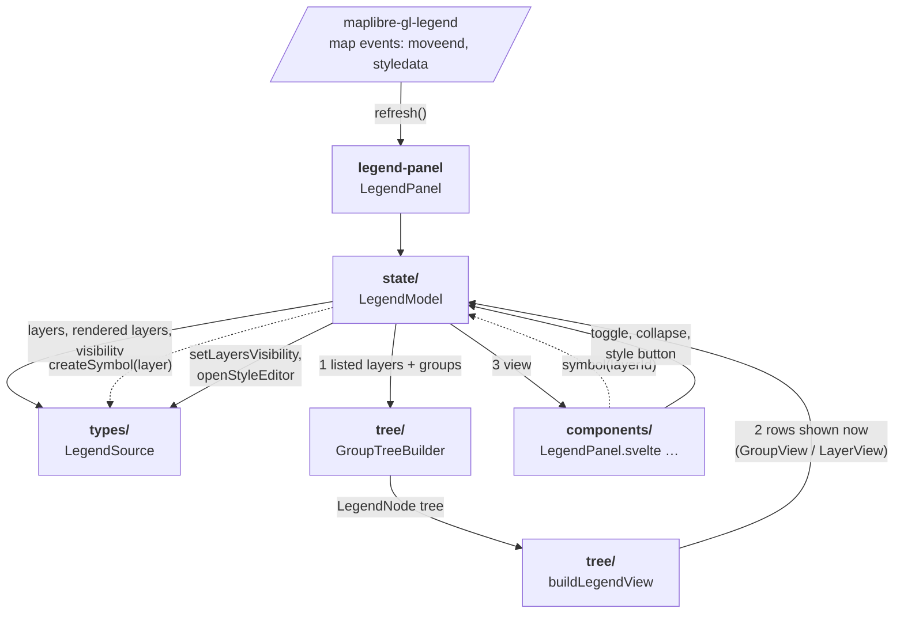
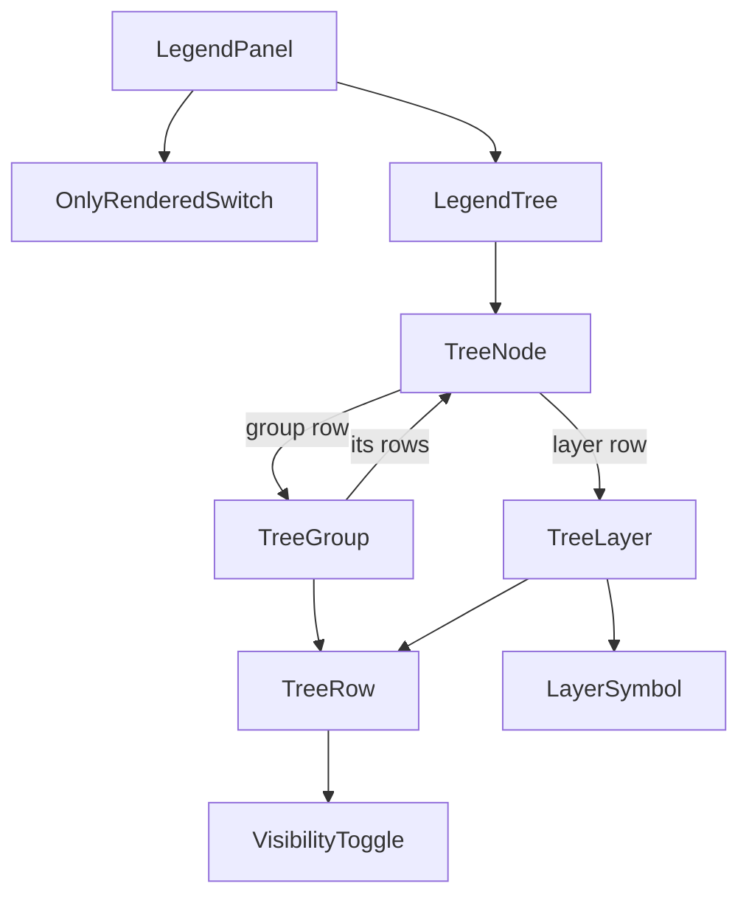
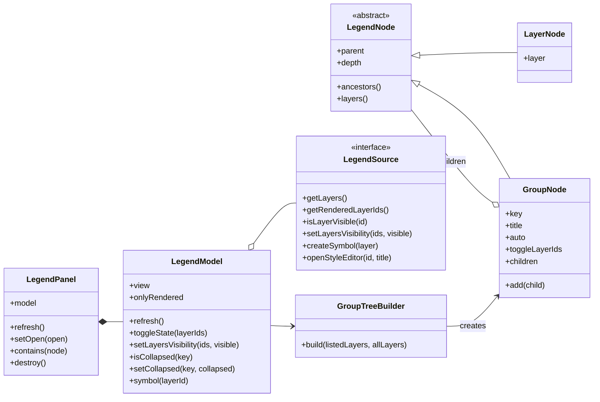

# @watergis/legend-ui

The Svelte UI of the legend panel of [maplibre-gl-legend](https://github.com/watergis/maplibre-gl-legend/tree/main/packages/maplibre-gl-legend).

The panel lists the layers of a map as a tree. Each row shows:

- on the left, the symbol of the layer (or the chevron of a group) and its title
- on the right, the style editor button and the visibility toggle (eye), with the eye at the right end so that the eyes of all rows line up

Groups of layers (the `groups` option) can be nested to any depth. Each level is indented, with a vertical guide line under the chevron of its group.

This is an internal package of this repository. `@watergis/maplibre-gl-legend` bundles it, together with its styles, and it is not published to npm.

- API reference: <https://maplibre-gl-legend.water-gis.com/docs/modules/_watergis_legend-ui.html>
- Storybook: <https://maplibre-gl-legend.water-gis.com/stories>

## Usage

The panel does not use the map directly. It reads everything through a `LegendSource`: the layers, which layers are rendered, their visibility and their symbols. maplibre-gl-legend implements it with a MapLibre map and maplibre2svg (`MaplibreLegendSource`).

```ts
import { LegendPanel, type LegendSource } from '@watergis/legend-ui';

const source: LegendSource = {
	getLayers: () => map.getStyle().layers,
	getRenderedLayerIds: () => new Set(map.queryRenderedFeatures().map((f) => f.layer.id)),
	isLayerVisible: (id) => map.getLayoutProperty(id, 'visibility') !== 'none',
	setLayersVisibility: (ids, visible) =>
		ids.forEach((id) => map.setLayoutProperty(id, 'visibility', visible ? 'visible' : 'none')),
	// { type: 'single', svg } | { type: 'classes', svg } | { type: 'none' } | { type: 'error' }
	createSymbol: (layer) => drawSymbol(layer),
	openStyleEditor: (layerId, title) => editor.open({ layerId, title })
};

const panel = new LegendPanel({
	target: controlContainer, // e.g. the element of a MapLibre control
	source,
	targets: { pipeline: 'Pipeline', wtp: 'WTP' }, // {}: all layers, titled by their IDs
	options: {
		groups: {
			'Water Facilities': { WTP: ['wtp', 'wtp_annotation'], Tank: ['tank', 'tank_annotation'] },
			Pipeline: ['pipeline', 'pipeline_annotation']
		},
		showStyleEditor: true
	},
	onClose: () => (legendButton.hidden = false)
});

map.on('moveend', () => panel.refresh());
map.on('styledata', () => panel.refresh());
```

`LegendPanel` has these methods:

| Method           | Description                                                            |
| ---------------- | ---------------------------------------------------------------------- |
| `refresh()`      | Reads the source again and updates the rows. The panel state is kept.  |
| `setOpen(open)`  | Shows or hides the panel. `isOpen` tells whether it is shown.          |
| `contains(node)` | Whether a node is in the panel, e.g. to ignore clicks inside it.       |
| `destroy()`      | Removes the panel.                                                     |
| `model`          | The `LegendModel`: the rows, the "Only rendered" switch and the state. |

The panel state kept by `refresh()` is the groups collapsed by the user and the layers hidden with a toggle.

## Options

`options` takes these fields (`LegendPanelOptions`). maplibre-gl-legend passes its own `LegendOptions` here.

| Option               | Default           | Description                                                                      |
| -------------------- | ----------------- | -------------------------------------------------------------------------------- |
| `title`              | `'Legend'`        | The title at the top of the panel.                                               |
| `onlyRenderedLabel`  | `'Only rendered'` | The label of the "Only rendered" switch.                                         |
| `onlyRendered`       | `true`            | The initial state of the switch: list only the layers rendered in the view.      |
| `showCheckbox`       | `true`            | A visibility toggle (eye) at the right end of each row.                          |
| `showStyleEditor`    | `false`           | A style editor button at the left of the eye. It calls `source.openStyleEditor`. |
| `reverseOrder`       | `true`            | The top-most layer (the last one of `style.layers`) comes first.                 |
| `groups`             | none              | Groups of layers, nested to any depth (see below).                               |
| `groupBySourceLayer` | `false`           | Group the layers that are not in `groups` and share a source and source-layer.   |
| `collapseGroups`     | `false`           | Show the groups collapsed at first, at every level.                              |

### Groups

The members of a group are either:

- an array of layer IDs, which can also contain objects of nested groups
- an object of nested groups

```ts
import type { LegendGroups } from '@watergis/legend-ui';

const groups: LegendGroups = {
	// a group of layers
	Pipeline: ['pipeline', 'pipeline_annotation'],
	// a group of groups
	'Water Facilities': {
		WTP: ['wtp', 'wtp_annotation'],
		Tank: ['tank', 'tank_annotation']
	},
	// a group of layers and groups
	'All Points': [{ 'Some Points': ['points-halo', 'points-circles'] }, 'points-symbols']
};
```

- A group is placed at the position of its first listed layer, at every level.
- A layer belongs to the first group that lists it.
- A layer that is not in `targets` is not listed, but its groups still switch it.
- A group with only one listed layer is shown as that layer's row. The toggle of the row switches the whole group.
- A group is hidden when none of its layers is shown, e.g. none is rendered while "Only rendered" is on. It is also hidden when its layers have nothing to draw.
- The toggle of a group switches the layers of all its nested groups. It is partially checked when only some of them are visible.
- Collapsing a group hides all of its nested groups. Each group keeps its own collapsed state.
- Groups with the same title under different parents are separate groups, each keyed by its path of titles.

## How it works

The source folders follow the roles of the code:

| Folder        | Contents                                                            | Role                                                                                      |
| ------------- | ------------------------------------------------------------------- | ----------------------------------------------------------------------------------------- |
| `types/`      | `LegendGroups`, `LegendPanelOptions`, `LegendSource`, `LayerSymbol` | The options, and the interface of what the panel needs from the map.                      |
| `tree/`       | `GroupTreeBuilder`, `LegendNode`, `buildLegendView`                 | Makes the tree of layers and groups, then the rows shown now. Plain TypeScript, no DOM.   |
| `state/`      | `LegendModel`                                                       | The state of the panel (`$state`): the rows, the switch, collapsed groups and visibility. |
| `components/` | `LegendPanel.svelte`, `TreeGroup.svelte`, ...                       | The Svelte components. They read the model and call its methods on user actions.          |
| `legend.css`  |                                                                     | The styles, with the class names of maplibre-gl-legend.                                   |

### Data flow

`refresh()` reads the source, builds the tree, and turns it into the rows to show. The components draw the rows. User actions go back through the model to the source.



### Components

`TreeNode` and `TreeGroup` call each other, so groups nest to any depth.



`TreeRow` is the frame shared by group and layer rows:

```text
[indent][chevron | symbol][title] …………… [style button][eye]
```

- The indent has one guide line per level.
- The chevron (`TreeGroup`) or symbol (`TreeLayer`) is passed as a snippet.
- The style column is empty on group rows, so the eyes of all rows line up.

### Classes



## Styling

The styles are in [`src/lib/legend.css`](src/lib/legend.css). They are global, not scoped to the components, and use the class names of maplibre-gl-legend, so rules that override them keep working. The panel is shown in a `.maplibregl-ctrl.maplibregl-ctrl-group` element. Its buttons are styled with that prefix so that they override the buttons of MapLibre controls.

### Custom properties

To restyle the panel, override these on `.maplibregl-legend-list`. Icons are CSS masks: only their shape is used, and their color comes from the color properties.

| Property                                     | Default                                 | Description                                                                       |
| -------------------------------------------- | --------------------------------------- | --------------------------------------------------------------------------------- |
| `--maplibregl-legend-icon-visible`           | Lucide `eye`                            | Icon of a visible layer or group.                                                 |
| `--maplibregl-legend-icon-hidden`            | Lucide `eye-off`                        | Icon of a hidden layer or group.                                                  |
| `--maplibregl-legend-icon-close`             | Lucide `x`                              | Icon of the close button.                                                         |
| `--maplibregl-legend-icon-chevron`           | Lucide `chevron-down`                   | Icon of the button collapsing a group (rotated while collapsed).                  |
| `--maplibregl-legend-icon-style`             | Lucide `palette`                        | Icon of the style editor button.                                                  |
| `--maplibregl-legend-icon-missing`           | Lucide `square-exclamation-point`       | Icon of a symbol whose icon the legend cannot show, such as of `["get", "icon"]`. |
| `--maplibregl-legend-icon-size`              | `16px`                                  | Size of the eye, chevron and style icons.                                         |
| `--maplibregl-legend-icon-color`             | `#1c1c1c`                               | Color of the visible eye and the chevron.                                         |
| `--maplibregl-legend-icon-hidden-color`      | `#9a9a9a`                               | Color of the hidden eye.                                                          |
| `--maplibregl-legend-icon-partial-color`     | `#9a9a9a`                               | Color of the eye of a partially visible group.                                    |
| `--maplibregl-legend-close-icon-size`        | `16px`                                  | Size of the close icon.                                                           |
| `--maplibregl-legend-close-icon-color`       | `#1c1c1c`                               | Color of the close icon.                                                          |
| `--maplibregl-legend-style-icon-color`       | `#6b6b6b`                               | Color of the style editor button.                                                 |
| `--maplibregl-legend-style-icon-hover-color` | `--maplibregl-legend-focus-color`       | Color of the style editor button on hover.                                        |
| `--maplibregl-legend-missing-icon-color`     | `#9a9a9a`                               | Color of the missing icon.                                                        |
| `--maplibregl-legend-switch-width`           | `28px`                                  | Width of the "Only rendered" switch.                                              |
| `--maplibregl-legend-switch-height`          | `16px`                                  | Height of the switch.                                                             |
| `--maplibregl-legend-switch-thumb-size`      | `12px`                                  | Size of the knob of the switch.                                                   |
| `--maplibregl-legend-switch-on-color`        | `#3b82f6`                               | Color of the switch when on.                                                      |
| `--maplibregl-legend-switch-off-color`       | `#c4c4c4`                               | Color of the switch when off.                                                     |
| `--maplibregl-legend-switch-thumb-color`     | `#ffffff`                               | Color of the knob.                                                                |
| `--maplibregl-legend-divider`                | `1px solid #e5e5e5`                     | Line between the top-level rows, and under the switch.                            |
| `--maplibregl-legend-group-divider`          | `none`                                  | Line between the rows of a group.                                                 |
| `--maplibregl-legend-group-divider-inset`    | `8px`                                   | How much shorter the line between the rows of a group is, on each side.           |
| `--maplibregl-legend-group-indent`           | `--maplibregl-legend-icon-size` + `4px` | How much each level of the tree is indented.                                      |
| `--maplibregl-legend-tree-guide-color`       | `#e5e5e5`                               | Color of the vertical guide lines (`transparent`: no line).                       |
| `--maplibregl-legend-text-color`             | `#1c1c1c`                               | Color of the titles and labels.                                                   |
| `--maplibregl-legend-focus-color`            | `#3b82f6`                               | Color of the keyboard focus outline.                                              |

```css
.maplibregl-legend-list {
	--maplibregl-legend-icon-color: #0f766e;
	--maplibregl-legend-switch-on-color: #0f766e;
	/* a wider indent, and darker guide lines */
	--maplibregl-legend-group-indent: 28px;
	--maplibregl-legend-tree-guide-color: #9ca3af;
	/* lines between the rows of a group */
	--maplibregl-legend-group-divider: 1px dashed #e5e5e5;
	/* any SVG works as an icon */
	--maplibregl-legend-icon-close: url('./my-close-icon.svg');
}
```

### Elements

The elements of the panel and their classes, for rules that the custom properties do not cover:

```text
div.maplibregl-legend-list                         the panel
├── button.maplibregl-legend-close-button
├── div.maplibregl-legend-title-label
├── div.maplibregl-legend-onlyRendered             "Only rendered" switch
│   ├── input.maplibregl-legend-onlyRendered-checkbox
│   └── label.maplibregl-legend-onlyRendered-label
└── div.maplibregl-legend-table-wrapper            scrolls
    └── ul.maplibregl-legend-tree
        ├── li.maplibregl-legend-node.maplibregl-legend-group      a group
        │   ├── div.maplibregl-legend-row.maplibregl-legend-group-header
        │   │   ├── span.maplibregl-legend-indent
        │   │   ├── button.maplibregl-legend-group-collapse        chevron
        │   │   ├── span.maplibregl-legend-label
        │   │   ├── span.maplibregl-legend-style-slot              empty
        │   │   └── input.maplibregl-legend-visibility-toggle.maplibregl-legend-group-toggle
        │   └── ul.maplibregl-legend-children                      its rows, while expanded
        └── li.maplibregl-legend-node.maplibregl-legend-layer      a layer
            ├── div.maplibregl-legend-row
            │   ├── span.maplibregl-legend-indent
            │   ├── span.maplibregl-legend-symbol
            │   ├── span.maplibregl-legend-label
            │   ├── span.maplibregl-legend-style-slot > button.maplibregl-legend-style-button
            │   └── input.maplibregl-legend-visibility-toggle
            └── div.maplibregl-legend-classes                     classes of a layer styled by data
                ├── span.maplibregl-legend-indent
                └── span.maplibregl-legend-classes-symbols > svg
```

- A group row has `data-group` with the key of the group.
- A layer row has `data-layer` with the layer ID.
- A row has `--maplibregl-legend-depth` (0 at the top level), and its indent has `--maplibregl-legend-tree-levels`.

```css
/* the titles of the groups in the color of the theme, and smaller labels */
.maplibregl-legend-list .maplibregl-legend-group-header .maplibregl-legend-label {
	color: #0f766e;
}
.maplibregl-legend-list .maplibregl-legend-label {
	font-size: 13px;
}
/* a layer, by its ID */
.maplibregl-legend-list li[data-layer='pipeline'] .maplibregl-legend-label {
	font-style: italic;
}
```

## Development

```bash
pnpm storybook        # Storybook on http://localhost:6009
pnpm test             # unit tests of the tree and the model
pnpm lint             # prettier, eslint and svelte-check
pnpm build            # svelte-package into dist/, used by maplibre-gl-legend
pnpm build-storybook  # static Storybook into storybook-static/
```

Every component has stories and a Docs page. They use a mock legend source (`src/stories/mock-source.ts`) and the layers of `src/stories/fixtures.ts`, without a map. `src/stories/ModelFrame.svelte` makes the model and shows the components inside a MapLibre control element, as maplibre-gl-legend does.

The API reference of all packages is built with `pnpm build:docs` at the repository root, after `pnpm build`.
