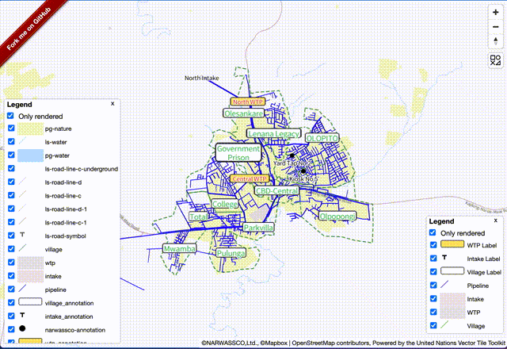

# mapbox-gl-legend


[](https://www.npmjs.com/package/@watergis/mapbox-gl-legend)

This module adds legend control which is able to create legend panel from mapbox style to mapbox-gl.

This module is using source code of [orangemug/legend-symbol](https://github.com/orangemug/legend-symbol). I just adopted this library to normal Mapbox GL Plugin. Thanks so much to develop this library!

This package was moved from [watergis/mapbox-gl-legend](https://github.com/watergis/mapbox-gl-legend) to [watergis/maplibre-gl-legend](https://github.com/watergis/maplibre-gl-legend) monorepo since v2.0.0.

## for MapLibre GL JS users

Please consider to use [@watergis/maplibre-gl-legend](../maplibre-gl-legend/) for MapLibre GL JS.

## Installation

```bash
pnpm i -D @watergis/mapbox-gl-legend mapbox-gl
```

## Demo

See [demo](https://maplibre-gl-legend.water-gis.com).



## Usage

```ts
import { MapboxLegendControl } from '@watergis/mapbox-gl-legend';
import '@watergis/mapbox-gl-legend/dist/mapbox-gl-legend.css';
import mapboxgl, { Map } from 'mapbox-gl';
import 'mapbox-gl/dist/mapbox-gl.css';

mapboxgl.accessToken = 'your mapbox access token';

const map = new Map({ container: 'map', style: 'your style url' });

// please add legend control after loading stylefiles, otherwise it causes errors...
map.on('load', function () {
	const targets = {
		pipeline: 'Pipeline',
		meter: 'Water Meter',
		valve: 'Valve'
	};

	// add legend control without checkbox, and it will be hide as default
	map.addControl(
		new MapboxLegendControl(targets, {
			showDefault: false,
			showCheckbox: false,
			onlyRendered: true,
			reverseOrder: true
		}),
		'top-right'
	);

	// add legend control with all layers
	map.addControl(new MapboxLegendControl({}, { reverseOrder: false }), 'bottom-left');
});
```

Specify your layers which you want to add the legend by the control.

### Options

- showDefault
  - true: Legend will be shown as default
  - false: Legend will be hide as default
  - default value is `true` if you don't specify the option.
- showCheckbox
  - true: the checkbox for switching visibility will be added as default
  - false: the checkbox will not be added as default
  - default value is `true` if you don't specify the option.
- reverseOrder
  - true: layers will be ordered from top.
  - false: layers will be ordered from bottom.
  - default value is `true` if you don't specfify the option.
- onlyRendered
  - true: only rendered layers will be shown on legend as default.
  - false: all layers' legend will be shown as default.
  - default value will be true.
- title
  - the text shown above the icons
  - default: "Legend"
- onlyRenderedLabel
  - the label text of the "Only rendered" checkbox. Use it to translate the label into other languages.
  - default: "Only rendered"
- accessToken
  - Mapbox access token used to load `mapbox://` sprites.
  - default: `mapboxgl.accessToken`

### Use CDN

```html
<link href="https://api.mapbox.com/mapbox-gl-js/v3.26.0/mapbox-gl.css" rel="stylesheet" />
<link
	href="https://cdn.jsdelivr.net/npm/@watergis/mapbox-gl-legend@latest/dist/mapbox-gl-legend.css"
	rel="stylesheet"
/>
<script type="importmap">
	{ "imports": { "mapbox-gl": "https://esm.sh/mapbox-gl@3.26.0" } }
</script>
<script type="module">
	import mapboxgl from 'mapbox-gl';
	import { MapboxLegendControl } from 'https://cdn.jsdelivr.net/npm/@watergis/mapbox-gl-legend@latest/dist/mapbox-gl-legend.es.js';

	mapboxgl.accessToken = 'your mapbox access token';
	const map = new mapboxgl.Map({ container: 'map', style: 'your style url' });
	map.on('load', () => {
		map.addControl(new MapboxLegendControl({}, { showDefault: true }), 'top-right');
	});
</script>
```

## Development

Copy `.env.example` to `.env` and set your Mapbox access token.

```
pnpm lint
pnpm format
pnpm dev
```

open [http://localhost:5173](http://localhost:5173).

## Build package

```
pnpm build
```

The modules will be generated under `dist` folder.
