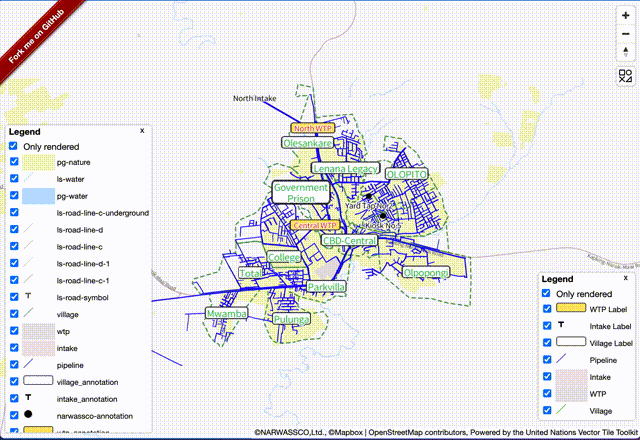

# maplibre-gl-legend


This module adds legend control which is able to create legend panel from mapbox style to maplibre-gl. It was forked from [mapbox-gl-legend](https://github.com/watergis/mapbox-gl-legend).

Legend symbols are drawn as SVG from the map's style by [maplibre2svg](../maplibre2svg) (bundled in this package).

## Installation:

```bash
pnpm i -D @watergis/maplibre-gl-legend maplibre-gl
```

## Demo:

Try [codesandbox](https://codesandbox.io/s/mapbox-gl-legend-0x6f0).

See [demo](https://maplibre-gl-legend.water-gis.com).



## Usage:

```ts
import { MaplibreLegendControl } from "@watergis/maplibre-gl-legend";
import '@watergis/maplibre-gl-legend/dist/maplibre-gl-legend.css';
import maplibregl from 'maplibre-gl';

const map = new maplibregl.Map();
//please add legend control after loading mapbox stylefiles, otherwise it causes errors...
map.on('load', function() {
const targets = {
  'pipeline': 'Pipeline',
  'pipeline_annotation': 'Pipeline Label', 
  'meter': 'Water Meter',
  'flow meter': 'Flow Meter', 
  'valve': 'Valve', 
  'firehydrant': 'Fire Hydrant', 
  'washout': 'Washout',
  'tank': 'Tank', 
  'tank_annotation': 'Tank Label', 
  'wtp': 'WTP', 
  'wtp_annotation': 'WTP Label', 
  'intake': 'Intake', 
  'intake_annotation': 'Intake Label', 
  'parcels': 'Parcels', 
  'parcels_annotation': 'Parcels Label', 
  'village': 'Village', 
  'village_annotation': 'Village Label', 
  'dma': 'DMA',
  'dma_annotation': 'DMA Label', 
};

// add legend control without checkbox, and it will be hide as default
map.addControl(new MaplibreLegendControl(targets, {showDefault: false, showCheckbox: false, onlyRendered: false }), 'top-right');

// add legend control with checkbox, and it will be shown as default
map.addControl(new MaplibreLegendControl(targets, {showDefault: true}), 'bottom-right');

// add legend control with all layers, and it reverse layer order
map.addControl(new MaplibreLegendControl({}, {reverseOrder: false}), 'bottom-left');

// group layers: layers in a group are listed under the group title, and switched on/off together
map.addControl(new MaplibreLegendControl(targets, {
  groups: {
    'Pipeline': ['pipeline', 'pipeline_annotation'],
    'Water Facilities': ['wtp', 'wtp_annotation', 'tank', 'tank_annotation'],
  },
}), 'top-left');

// if you want to use basemap from Mapbox in v2
map.addControl(new MaplibreLegendControl({}, {accesstoken: 'your mapbox accesstoken'}));
```

Specify your layers which you want to add the legend by the control.

### Options
- showDefault
  - true: Legend will be shown as default
  - false: Legend will be hide as default
  - default value is `true` if you don't specify the option.
- showCheckbox
  - true: the checkbox for switching visibility will be added as default
  - false: the checkbox will not be added as default
  - default value is `true` if you don't specify the option.
- reverseOrder
  - true: layers will be ordered from top. 
  - false: layers will be ordered from bottom. 
  - default value is `true` if you don't specfify the option.
- onlyRendered
  - true: only rendered layers will be shown on legend as default. 
  - false: all layers' legend will be shown as default. 
  - default value will be true.
- title
  - the text shown above the icons
  - default: "Legend"
- onlyRenderedLabel
  - the label text of the "Only rendered" checkbox. Use it to translate the label into other languages.
  - default: "Only rendered"
- groups
  - groups of layers: an object of the group title and the IDs of the layers in the group. e.g. `{ 'Pipeline': ['pipeline', 'pipeline_annotation'] }`
  - the layers of a group are listed under the group title. The checkbox of the group switches all of its layers on/off, and each layer still has its own checkbox. The group can be collapsed.
  - layers in the groups are shown even if they are not in `targets`. A layer belongs to the first group listing it.
  - default: no group
- groupBySourceLayer
  - true: layers not in `groups` which share the same source and `source-layer` are grouped automatically, titled by the source-layer name. A source-layer used by only one layer is not grouped.
  - false: layers are not grouped automatically.
  - default value is `true`.
- collapseGroups
  - true: groups are collapsed as default.
  - false: groups are expanded as default.
  - default value is `false`.

### Customizing styles

The icons (layer visibility eye / eye-off, close button) and the "Only rendered" switch are drawn entirely by CSS, using [Lucide](https://lucide.dev) icons by default. Override the CSS custom properties on `.maplibregl-legend-list` to change them. Icons are applied as CSS masks, so only their shape is used; set their color with the color properties.

| Property | Default | Description |
| --- | --- | --- |
| `--maplibregl-legend-icon-visible` | Lucide `eye` | icon of a visible layer |
| `--maplibregl-legend-icon-hidden` | Lucide `eye-off` | icon of a hidden layer |
| `--maplibregl-legend-icon-close` | Lucide `x` | icon of the close button |
| `--maplibregl-legend-icon-chevron` | Lucide `chevron-down` | icon of the button collapsing a group |
| `--maplibregl-legend-icon-size` | `16px` | size of the visibility icons |
| `--maplibregl-legend-icon-color` | `#1c1c1c` | color of the visible icon |
| `--maplibregl-legend-icon-hidden-color` | `#9a9a9a` | color of the hidden icon |
| `--maplibregl-legend-icon-partial-color` | `#9a9a9a` | color of the visible icon of a partially visible group |
| `--maplibregl-legend-close-icon-size` | `16px` | size of the close icon |
| `--maplibregl-legend-close-icon-color` | `#1c1c1c` | color of the close icon |
| `--maplibregl-legend-switch-width` | `28px` | width of the switch |
| `--maplibregl-legend-switch-height` | `16px` | height of the switch |
| `--maplibregl-legend-switch-thumb-size` | `12px` | size of the switch knob |
| `--maplibregl-legend-switch-on-color` | `#3b82f6` | switch color when on |
| `--maplibregl-legend-switch-off-color` | `#c4c4c4` | switch color when off |
| `--maplibregl-legend-switch-thumb-color` | `#ffffff` | color of the switch knob |
| `--maplibregl-legend-divider` | `1px solid #e5e5e5` | line between layers |
| `--maplibregl-legend-group-indent` | `16px` | indent of the layers in a group |
| `--maplibregl-legend-text-color` | `#1c1c1c` | text color |
| `--maplibregl-legend-focus-color` | `#3b82f6` | keyboard focus outline color |

```css
.maplibregl-legend-list {
	--maplibregl-legend-icon-color: #0f766e;
	--maplibregl-legend-switch-on-color: #0f766e;
	--maplibregl-legend-divider: 1px dashed #ccc;
	/* any SVG works as an icon */
	--maplibregl-legend-icon-close: url('./my-close-icon.svg');
}
```

### Use CDN

maplibre-gl v6 is distributed as ES modules only, so load both maplibre-gl and this plugin with `<script type="module">`.

```html
<link href='https://unpkg.com/maplibre-gl@6.16.0/dist/maplibre-gl.css' rel='stylesheet' />
<link href='https://www.unpkg.com/@watergis/maplibre-gl-legend@latest/dist/maplibre-gl-legend.css' rel='stylesheet' />
<script type="module">
import * as maplibregl from 'https://unpkg.com/maplibre-gl@6.16.0/dist/maplibre-gl.mjs';
import { MaplibreLegendControl } from 'https://www.unpkg.com/@watergis/maplibre-gl-legend@latest/dist/maplibre-gl-legend.es.js';

const map = new maplibregl.Map({ /* your map options */ });

map.on('load', function() {
    const targets = {
        'pipeline': 'Pipeline',
        'pipeline_annotation': 'Pipeline Label', 
        'meter': 'Water Meter',
        'flow meter': 'Flow Meter', 
        'valve': 'Valve', 
        'firehydrant': 'Fire Hydrant', 
        'washout': 'Washout',
        'tank': 'Tank', 
        'tank_annotation': 'Tank Label', 
        'wtp': 'WTP', 
        'wtp_annotation': 'WTP Label', 
        'intake': 'Intake', 
        'intake_annotation': 'Intake Label', 
        'parcels': 'Parcels', 
        'parcels_annotation': 'Parcels Label', 
        'village': 'Village', 
        'village_annotation': 'Village Label', 
        'dma': 'DMA',
        'dma-annotation': 'DMA Label', 
        'contour-line': 'Countour',
        'contour-label': 'Contour Label',
        'hillshade': 'Hillshade'
    };
    map.addControl(new MaplibreLegendControl(targets, {
        showDefault: false, 
        showCheckbox: false, 
        onlyRendered: true,
        reverseOrder: true
    }), 'top-right');
})
</script>
```

Furthermore, you may download specific version's scripts and css locally from [NPM](https://www.npmjs.com/package/@watergis/maplibre-gl-legend) page.

See an example HTML at [index_es.html](./index_es.html)

## Development

```
pnpm lint
pnpm format
pnpm dev
```

open [http://localhost:5173](http://localhost:5173).

If there are any changes on source code, it will be reflected automatically.

## Build package

```
pnpm build
```

The modules will be generated under `dist` folder.
