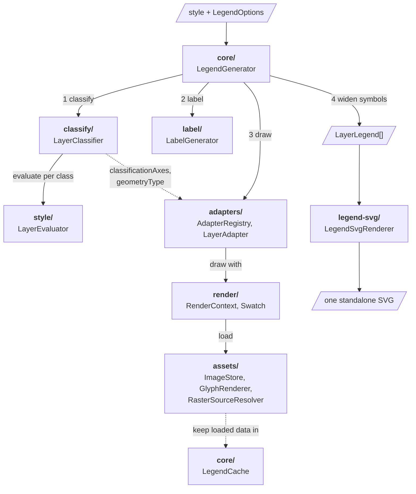
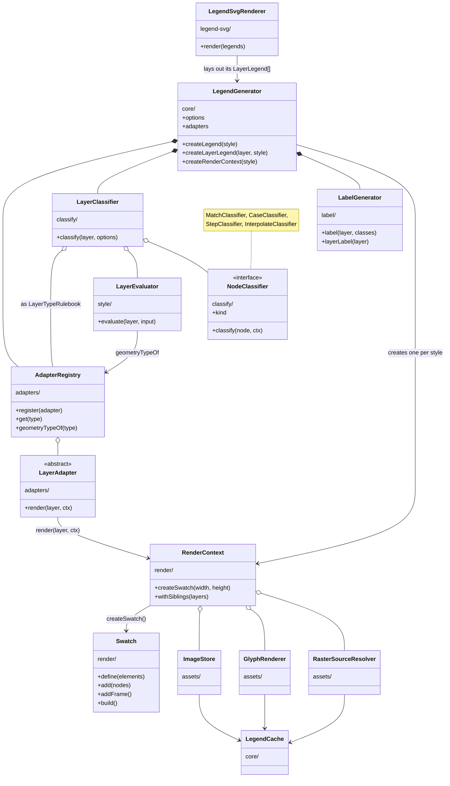
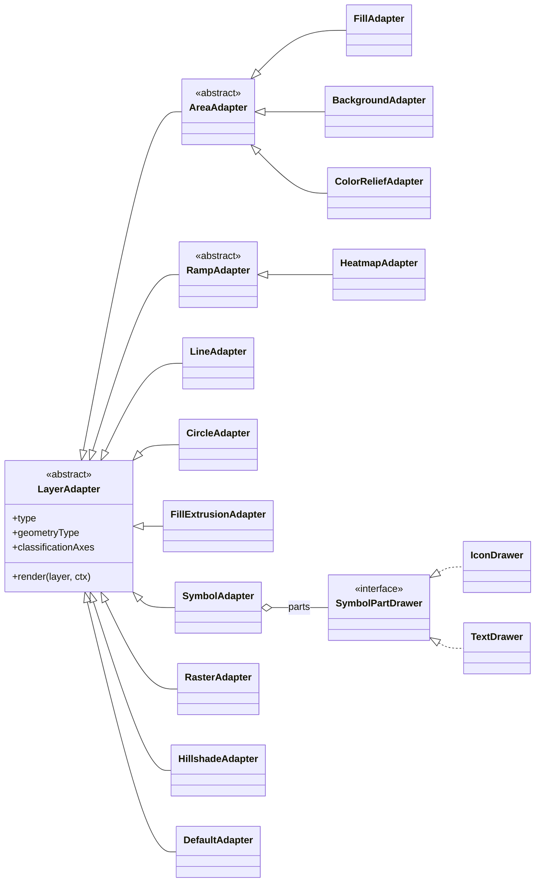

# maplibre2svg

Draws legend symbols as SVG from the layers of a MapLibre style.

Given a style, it works out the classes of each layer (the branches of a `match`, the intervals of a `step`, the stops of an `interpolate`, the conditions of a `case`), evaluates the layer for one representative feature per class, and draws a small SVG symbol for each: a filled rectangle for a fill, a line at its real width and dash pattern, a circle at its radius, the icon and label of a symbol layer, a color ramp for a heatmap, a tile thumbnail for a raster layer, and so on.

This is an internal package of this repository. [`@watergis/maplibre-gl-legend`](https://github.com/watergis/maplibre-gl-legend/tree/main/packages/maplibre-gl-legend) uses it to draw the symbols of its legend control. It is not published to npm.

- API reference: <https://maplibre-gl-legend.water-gis.com/docs/modules/_watergis_maplibre2svg.html>
- Storybook: <https://maplibre-gl-legend.water-gis.com/maplibre2svg/stories>

## Usage

```ts
import { createLegend, legendToSvg } from '@watergis/maplibre2svg';

const legends = await createLegend(map.getStyle(), {
	zoom: map.getZoom(),
	center: map.getCenter().toArray(),
	getImage: (id) => {
		const image = map.getImage(id);
		const rgba = image?.data;
		if (!rgba || !('data' in rgba)) return undefined;
		return {
			data: rgba.data,
			width: rgba.width,
			height: rgba.height,
			pixelRatio: image.pixelRatio,
			sdf: image.sdf
		};
	},
	listImages: () => map.listImages()
});

for (const legend of legends) {
	for (const entry of legend.entries) {
		// entry.svg is an <svg> element; entry.label is its label
		row.append(entry.svg, entry.label);
	}
}

// or all legends as one standalone SVG
const svg = legendToSvg(legends, { titles: 'multi' });
```

`createLayerLegend(layer, style, options)` does the same for a single layer. Each `LayerLegend` has the layer id, type and label, and its entries. Each entry has the label, the kind of class (`single`, `category`, `range`, `stop`, `default` or `ramp`), and the `<svg>` with its width and height. A `ramp` entry also carries the sampled ramp, so that a host can print its range.

To update a legend when the map moves, keep one cache between calls so that glyphs, images and tiles are not loaded again:

```ts
const cache = createLegendCache();
map.on('moveend', async () => {
	const legends = await createLegend(map.getStyle(), { zoom: map.getZoom(), cache });
	// ...
});
```

`new LegendGenerator(options)` keeps the options and the cache for several calls of `createLegend` / `createLayerLegend`.

## Options

| Option             | Default                       | Description                                                                       |
| ------------------ | ----------------------------- | --------------------------------------------------------------------------------- |
| `zoom`             | `0`                           | Zoom level the expressions are evaluated at.                                      |
| `center`           | `[0, 0]`                      | `[lng, lat]` of the map, for the tile shown for a raster layer.                   |
| `getImage`         | none                          | Gets an image of the style by id, for icons and patterns. See the example above.  |
| `listImages`       | none                          | The ids of the images, to pick an icon for an `icon-image` with `{tokens}`.       |
| `defaultLabel`     | `'Other'`                     | Label of the fallback class of a `match` or a `case`.                             |
| `swatch`           | `{ width: 30, height: 20, maxSize: 40, frame: true }` | Size of a symbol, and whether area symbols get a thin frame. |
| `glyphs`           | `true`                        | Draw labels with the glyphs of the style. `false` draws them with CSS fonts.      |
| `fetchGlyphs`      | `fetch`                       | Loads a glyph PBF, for hosts which route requests themselves.                     |
| `sampleText`       | `'Aa'`                        | Text drawn for a label whose `text-field` gives no text without a feature.        |
| `sources`          | the style's                   | Sources that override the style's, e.g. with TileJSON `tiles` resolved.           |
| `resolveRasterUrl` | none                          | Maps a tile URL to one the browser can load (custom protocols, signed URLs).      |
| `loadImage`        | `Image` of the document       | Checks that a tile loads; one that does not gets a placeholder.                   |
| `imageEncoder`     | canvas                        | Encodes RGBA pixels into an image URL.                                            |
| `measureText`      | canvas                        | Measures text in a CSS font.                                                      |
| `pixelRatio`       | `devicePixelRatio` (1 to 3)   | Resolution that tinted icons and label images are drawn at.                       |
| `cache`            | a new one per call            | A cache from `createLegendCache()`, shared between calls.                         |
| `document`         | the global `document`         | Document the SVG elements are created in.                                         |
| `adapters`         | none                          | Adapters that add layer types or replace a built-in one (see below).              |

A layer can override its labels in `metadata.legend`:

```json
"metadata": {
	"legend": {
		"label": "Land use",
		"default": "Everything else",
		"custom-labels": ["Homes", "Shops"],
		"show-default": false
	}
}
```

## Layer types

| Type             | Symbol                                                                                          |
| ---------------- | ----------------------------------------------------------------------------------------------- |
| `fill`           | Rectangle of `fill-color` or `fill-pattern`, with the outline when it has its own color.        |
| `line`           | Horizontal line with width, cap, join, dashes, gap width, gradient or pattern.                  |
| `circle`         | Circle at its radius with its stroke; the swatch grows with larger circles.                     |
| `fill-extrusion` | Isometric box; heights are relative to the other classes of the layer.                          |
| `background`     | Rectangle of `background-color` or `background-pattern`.                                        |
| `symbol`         | The icon (SDF icons tinted with `icon-color` and halo) and a sample of the label beside it.     |
| `raster`         | The tile at the center and zoom, with the color adjustments of the layer.                       |
| `hillshade`      | A small synthetic terrain shaded with the light and colors of the layer.                        |
| `heatmap`        | One ramp of `heatmap-color` over density 0–1.                                                   |
| `color-relief`   | One rectangle per elevation stop or interval of `color-relief-color`.                           |

Other layer types get a neutral grey rectangle.

## How it works

`createLegend` goes through four steps for each layer. Each step is a class, and the source folders follow them:

| Folder      | Class           | Step                                                                                              |
| ----------- | --------------- | ------------------------------------------------------------------------------------------------- |
| `classify/` | LayerClassifier | Finds the property that classifies the layer and splits it into classes, each with a representative feature. |
| `style/`    | LayerEvaluator  | Evaluates every paint and layout property for that feature.                                       |
| `label/`    | LabelGenerator  | Labels the classes and applies `metadata.legend`.                                                 |
| `adapters/` | LayerAdapter    | Draws the symbol of each class, one adapter per layer type, with `render/` and `assets/`.         |

`core/LegendGenerator` runs the steps and holds the options and the cache. `legend-svg/LegendSvgRenderer` lays legends out as one SVG.

### Modules

How a style becomes legends, and which module each step is in. Solid arrows are calls, dotted arrows are what a module reads from another.



### Classes

The main classes and what each one holds. `*--` is a class that creates and owns another, `o--` one that holds another given to it, and `-->` one that uses another. The layer adapters are in the diagram under the next paragraph.



Everything the legend knows about a layer type is in its adapter: the geometry type of its features, the properties its classes can come from (`classificationAxes`), and how a symbol is drawn (`render`). Each layer type has a folder under `adapters/` (`adapters/fill/`, `adapters/line/`, ...) with its adapter, its helpers and its tests. The shared base classes are in `adapters/base/`: `fill`, `background` and `color-relief` extend `AreaAdapter`, and `heatmap` extends `RampAdapter`. `AdapterRegistry` maps layer types to adapters.



## Adding or replacing an adapter

Subclass `LayerAdapter` (or a built-in adapter) and pass it in `adapters`. An adapter for an existing type replaces the built-in one.

```ts
import { createLegend, FillAdapter, type EvaluatedLayer, type RenderContext } from '@watergis/maplibre2svg';

/** Fills drawn as a circle instead of a rectangle */
class RoundFillAdapter extends FillAdapter {
	override async render(layer: EvaluatedLayer, ctx: RenderContext) {
		const { width, height } = ctx.swatch;
		const swatch = ctx.createSwatch(width, height);
		return swatch
			.add(
				swatch.el('circle', {
					cx: width / 2,
					cy: height / 2,
					r: height / 2 - 1,
					fill: String(layer.paint['fill-color'])
				})
			)
			.build();
	}
}

const legends = await createLegend(style, { adapters: [new RoundFillAdapter()] });
```

`ctx.createSwatch()` returns a `Swatch`, which collects definitions (`define`) and shapes (`add`), adds the neutral frame (`addFrame`) and builds the `<svg>`.

## Development

```bash
pnpm test             # unit tests and SVG snapshots of every story
pnpm lint
pnpm storybook        # Storybook on http://localhost:6006
pnpm build-storybook  # static Storybook into site/storybook
```

The API reference of all packages is built with `pnpm build:docs` at the repository root (after `pnpm build`).

`src/lib/regression.test.ts` renders every story with fixed images, glyphs and text widths and compares the SVG with a snapshot. If a change is meant to alter the output, check it in Storybook and update the snapshot with `pnpm test -u`.
